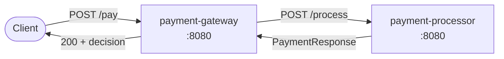
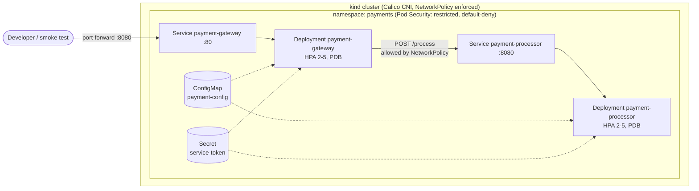

# Payment Gateway and Processor on local Kubernetes

Two small services (`payment-gateway` and `payment-processor`) deployed to a local
[kind](https://kind.sigs.k8s.io/) cluster with a production-minded baseline:
non-root containers, read-only filesystems, default-deny network policy, probes,
autoscaling, disruption budgets, and a repeatable smoke test.

One command builds everything: `make up`.

## Application flow



The gateway calls the processor with `Authorization: Bearer <SERVICE_TOKEN>` and an
`X-Request-ID` generated at the edge, so one payment can be traced across both services'
logs. Both services expose `/healthz` (liveness), `/readyz` (readiness) and `/metrics`.

## Deployed architecture



The processor is a ClusterIP Service that only gateway pods may call (see the network
policies below). Nothing is exposed outside the cluster; the smoke test uses `kubectl port-forward`.

## Prerequisites

- Docker, `kind`, `kubectl`, `make`, `curl`, `jq`, `openssl`, `git`
- macOS or Linux. On Windows, use WSL2 with Ubuntu and Docker Desktop's WSL integration,
  and run every command from the Ubuntu shell.
- About 6 GB of memory available to Docker (on WSL2, set `memory=6GB` in `.wslconfig`).
- Internet access (the cluster pulls Calico, metrics-server and the two images).

## Run it

```
make up      # cluster + Calico + metrics-server + secret + deploy + smoke test
make smoke   # re-run the smoke test
make chaos   # inject failures (FAILURE_RATE=0.3), see "Reliability notes"
make down    # delete the cluster
```

`make up` is safe to re-run. If the Calico manifest version is unavailable, pass a newer one:
`make up CALICO_VERSION=<release>`.

## What is deployed and why

| Area | Choice | Reason |
|---|---|---|
| Cluster | kind, 1 control-plane + 1 worker, default CNI disabled, Calico installed | kind's default CNI may not enforce NetworkPolicy; Calico guarantees the policies below are real |
| Config | 12-factor: env from a ConfigMap | behaviour (timeouts, retries, decline threshold) is tunable without rebuilding images |
| Secret | `SERVICE_TOKEN` generated per cluster with `openssl rand`, stored as a Kubernetes Secret, never committed | shared bearer token between gateway and processor; services fail closed if it is empty |
| Pod security | namespace labelled `restricted`; non-root (uid 10001), read-only root filesystem, all capabilities dropped, seccomp RuntimeDefault, no service-account token mounted | least privilege; pods were admitted by the `restricted` profile |
| Network | default-deny ingress and egress; explicit allow for DNS, gateway to processor, and ingress to the gateway | only the gateway can call the processor |
| Probes | startup and liveness on `/healthz`, readiness on `/readyz` | liveness never depends on the downstream service |
| Availability | 2 replicas each, rolling update with `maxUnavailable: 0`, PodDisruptionBudget (min 1), HPA 2 to 5 on CPU | zero-downtime rollouts and survivable node drains |
| Resources | request 100m CPU / 128Mi, memory limit 256Mi | set from measurement (see Findings) |
| Chaos knobs | `FAILURE_RATE` and `LATENCY_MS` stay 0 in the base; the `chaos` overlay sets them | failure testing without risking the normal deployment |

## Verification (results from this setup)

| Check | Result |
|---|---|
| Smoke test via port-forward: health, ready, approved (currency normalised to INR), declined above the limit, zero amount (422), bad currency (422) | all PASS |
| All pods Running, 0 restarts under the final resource settings | yes |
| HPA reads CPU from metrics-server | yes |
| Pod in another namespace calling the processor directly | `wget: download timed out` (blocked by default-deny) |
| Gateway pod calling `/process` without a token | `HTTP Error 401: Unauthorized` |
| 30 payments with `FAILURE_RATE=0.3` (3 attempts each) | 29 x `200`, 1 x `502` |
| After `kubectl apply -k k8s/base` and a restart | `FAILURE_RATE=0`, smoke test passes again |

## Findings during bring-up

1. **OOM kill from a too-tight memory limit.** With a 128Mi limit, running a second Python
   process in the gateway container (`kubectl exec`) exited with code 137 and restarted the
   container. `kubectl top` showed 82 to 111Mi in use per pod. Limits were raised to 256Mi and
   requests set to 128Mi; the same test then returned the expected 401.
2. **HPA scaled the gateway from 2 to 5 replicas** after that CPU spike, which also showed the
   50m CPU request was lower than real idle usage (about 30% of target). Requests were raised
   to 100m. For production, set them from a load test.
3. All pods land on the single worker, so `topologySpreadConstraints` (set to
   `ScheduleAnyway`) only take effect on multi-node clusters.

## Reliability notes

- **Failure mapping at the gateway:** 200 healthy, 422 invalid input, 502 processor 5xx or bad
  response, 503 processor unreachable, 504 processor too slow (all after retries).
- **Worst-case latency** (calculated from the defaults, not measured): with a 3s timeout and
  up to 3 attempts plus backoff, a hung processor takes roughly 9 to 10 seconds to return 504.
  Any ingress or client timeout must be larger than that, otherwise callers see the ingress
  error instead of the gateway's own status.
- **Readiness trade-off:** the gateway's `/readyz` depends on the processor. If the processor
  is down, all gateway pods become unready and clients get connection errors instead of the
  gateway's clean 503. The alternative is to use `/healthz` for gateway readiness. The
  current choice follows the service's documented contract.
- **Retries and money movement:** the gateway retries `POST /pay`. I did not verify whether the
  processor de-duplicates on `X-Request-ID` or `reference`. Without that, a retried request could
  be processed twice, so an idempotency key is the first thing to add.

## Production handover: what is done and what is next

**Done in this repo**
- Reproducible one-command setup with a smoke test
- Secrets generated locally and kept out of Git
- Hardened pods, namespace-level Pod Security, default-deny networking
- Probes, replicas, PDBs, HPAs, rolling updates without downtime
- Failure injection isolated in an overlay, with documented results

**Next, in priority order**
1. **Observability:** scrape `/metrics` with Prometheus (kube-prometheus-stack plus
   ServiceMonitors); dashboard for request rate, 5xx by status code, p95/p99 latency, and
   client-visible vs processor errors; alerts on 5xx ratio, latency, restarts and readiness
   flapping. Needs a NetworkPolicy rule allowing the monitoring namespace to scrape.
2. **Idempotency** for retried payments (see above).
3. **Secrets management:** External Secrets, Vault or Sealed Secrets, plus token rotation
   (accept two tokens during a rotation window).
4. **Supply chain:** pin images by digest, scan with Trivy in CI, generate an SBOM, sign with
   cosign. Images are currently pinned by tag (`1.0.0`).
5. **Transport security:** the gateway to processor hop is plain HTTP with a bearer token;
   production should use mTLS (service mesh or cert-manager).
6. **Delivery:** CI (manifest validation with kubeconform, shellcheck, Trivy) and GitOps
   (Argo CD) with per-environment overlays; a Helm chart would remove the duplication between
   the two Deployments.
7. **Ingress and SLOs:** an ingress with TLS and rate limiting, and SLOs (for example 99.9%
   availability, p99 under 1s) with burn-rate alerts.
8. **Not yet tested:** a clean-clone run of `make up` on a second machine, node-drain behaviour
   on a multi-node cluster, and a load test.

## Repository layout

```
Makefile                  one-command workflow
kind/cluster.yaml         cluster definition (Calico, no default CNI)
k8s/base/                 namespace, config, both services, network policies
k8s/overlays/chaos/       failure injection for reliability demos
scripts/smoke.sh          end-to-end checks used by `make smoke`
```